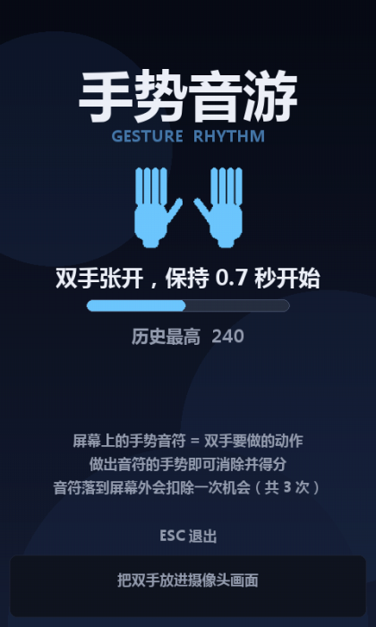
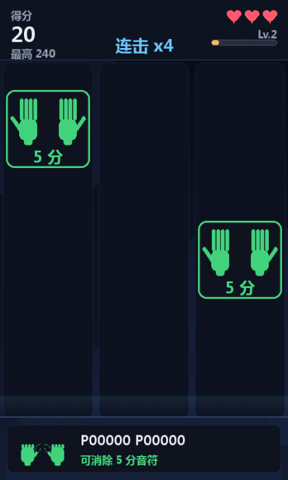
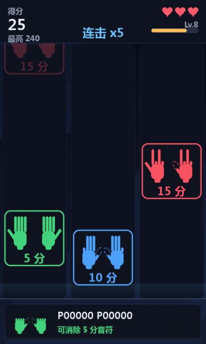
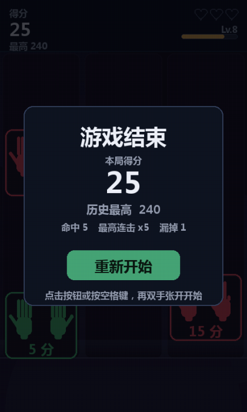

# 手势音游 / Gesture Rhythm

用**双手手势**玩的下落式音乐游戏。MediaPipe 识别整幅摄像头画面里的两只手并绘制骨骼；
游戏窗口里手势音符从顶端落下，用双手做出音符上的手势即可消除得分。



| 游戏中（低难度） | 游戏中（高难度，三种分值） | 游戏结束 |
| --- | --- | --- |
|  |  |  |

## 特性

- **两个窗口**：摄像头预览（双手骨骼 + LEFT/RIGHT 识别结果）与游戏窗口（420×700）。
- **双手识别**：MediaPipe Hands 处理整幅镜像画面，按关节夹角判断手指伸/屈，
  左右手按画面位置区分。
- **218 种手势音符**：5 / 10 / 15 分三档，分别用绿 / 蓝 / 红卡片和手势图表示。
- **完整对局**：双手张开开始 → 音符下落 → 做出手势消除 → 漏掉扣机会 → 3 次机会用尽结束 →
  显示历史最高分与「重新开始」。
- **难度递增**：音符更快、更密、高分更多，90 秒升到满难度。
- **无素材依赖**：手势图、音符卡片、音效全部由代码生成，只额外需要一个中文字体文件。

## 运行

首次安装（创建 `.venv` 并安装依赖）：

```bat
setup_env.bat
```

之后每次使用：

```bat
:: 1. 检查摄像头（会自动请求管理员权限，UAC 选择“是”）
check_camera.bat

:: 2. 启动游戏（会自动请求管理员权限，UAC 选择“是”）
run_game.bat
```

启动后会打开两个窗口：

- `Camera - Two Hands`：镜像后的摄像头画面，两只手的 21 个骨骼点、手腕旁的
  `LEFT/RIGHT + 编码` 标签；左上角 RECOGNITION 面板逐行显示 **LEFT / RIGHT 的识别结果**
  （6 字符编码 + 拇指伸出/折叠）以及合并后的 12 字符编码。
- `手势音游 / Gesture Rhythm`：游戏窗口（场景按 480×800 设计，等比缩小 87.5% 显示为 420×700）。

没有摄像头时会回退到虚拟摄像头：界面仍可启动，但**无法开始游戏**（开始必须双手张开）。
可用 `GAME_CAMERA=virtual` 强制虚拟摄像头、`GAME_NO_ELEVATE=1` 跳过提权、`GAME_NO_SOUND=1` 关闭音效、
`GAME_HAND_MODEL=1` 换用更精确但更慢的 MediaPipe 模型。

## 玩法

1. 双手张开保持 **0.7 秒**，游戏开始；**每一局都要这样开始**（结束后重新开始也一样）；
2. 手势音符从顶端下落，卡片上画着双手要做的动作和分值；**收起的大拇指会额外用虚线勾出伸出时的轮廓**，
   提示这只手的拇指要收起来；
3. 用双手做出卡片上的手势，即可消除**最靠下的那个**匹配音符并得分（0.22 秒冷却）；
4. 音符落到判定线以下算漏掉，扣 1 次机会，整局共 **3 次**；
5. 机会用尽 → 游戏结束，显示本局得分、历史最高分；点击「重新开始」或按空格回到开始界面，
   再双手张开开始新的一局。

键盘：ESC 退出；结束界面可用空格 / 回车 / 鼠标点击「重新开始」。

## 手势编码

一只手用 6 个字符表示：`[P|N] + 拇指、食指、中指、无名指、小指（1 展开 / 0 收起）`，
双手共 12 个字符，顺序是**画面左边的手 + 画面右边的手**。

拇指朝向：画面**左边**的手拇指朝**右**记 `P`、朝左记 `N`；画面**右边**的手拇指朝**左**记
`P`、朝右记 `N`（也就是 `P` 指向屏幕中央、`N` 指向外侧）。

手势按分值分成三档，共 **218** 种。其中有一条简化规则：**`N` 手（拇指朝外）的拇指必须是伸出的**
（朝外的拇指再收起来在画面里很难分辨，所以不要求玩家做），`P` 手不受限（拇指伸、屈都可以）：

| 分值 | 颜色 | 规则 | 数量 |
| --- | --- | --- | --- |
| 5 | 绿 | 两手手型相同，且是 `11111`（张开，P/N 任意）或 `00000`（握拳，只能 P） | 5 |
| 10 | 蓝 | 两手手型相同，且是 `01000` `01100` `01110` `01111` `00111` `11000` 之一；`11000` 可 P/N，其余只能 P | 9 |
| 15 | 红 | 两手手型**不同**，且各自取自上面 8 种手型加 `11010` `01010` `00101` `01001`；N 手按上面的规则 | 204 |

例如 `P00000P00000`（双手握拳、拇指朝内且收起）是 5 分音符，而 `N00000P00000` 不是音符
（`N` 手的拇指必须伸出）。其它编码（例如手型 `10101`）能识别但不属于音符，不匹配任何音符、也不扣分。

### 识别方式

每根长指只看**关节夹角**（3D）：PIP 关节 ≥ 158° 且 DIP 关节 ≥ 140° 才算伸直，
任何一个关节弯下去都判为收起（半握 150° 也算收起）。拇指的折叠是绕拇指根部旋转、
它自己的关节基本是直的，所以改用「IP 关节 ≥ 150° 且指尖离掌心 ≥ 0.72 倍掌宽」判断，
握拳时拇指搭在手指上不会被误判为伸出。最近 4 帧逐字符多数表决防抖；
「双手张开」的开始判定允许每只手有 1 根长指误判（≥ 3 根伸出即算张开）。

> 小技巧：双手离摄像头近一点、尽量占满画面中央，手指的像素更多，识别更稳；
> 摄像头窗口会实时显示 LEFT / RIGHT 的识别结果，可以对照检查是哪根手指被读错。

## 难度

`难度 = clamp(游戏时长 / 90 秒, 0, 1)`，三个参数同时变化：

| 参数 | 开局（d=0） | 满难度（d=1） |
| --- | --- | --- |
| 音符生成间隔 | 1.90 s | 0.55 s（再乘 0.85–1.15 抖动） |
| 基础下落速度 | 105 px/s | 290 px/s（单音符最高 +55%，越快概率越大） |
| 5 / 10 / 15 分概率 | 85% / 15% / 0% | 20% / 35% / 45% |

开局前两个音符固定 5 分，保证「难度尽可能低」的起步；红色音符约 11 秒后才可能出现。

## 项目结构

| 文件 | 职责 |
| --- | --- |
| [gesture_rhythm.py](gesture_rhythm.py) | 主程序：三个界面、摄像头窗口、主循环 |
| [gesture_twohands.py](gesture_twohands.py) | MediaPipe 双手识别、关节角判定、骨骼绘制、后台采集线程 |
| [gesture_catalog.py](gesture_catalog.py) | 12 字符编码 / 解码、218 个音符手势的分类表 |
| [gesture_icons.py](gesture_icons.py) | 程序化绘制手势图、音符卡片、当前手势面板 |
| [game_core.py](game_core.py) | 纯游戏逻辑：音符、难度、命中、机会、状态机、最高分 |
| [sound_effects.py](sound_effects.py) | numpy 合成的音效，无音频设备时自动关闭 |
| [camera_compat.py](camera_compat.py) | 摄像头探测与虚拟摄像头回退 |
| [capture_screens.py](capture_screens.py) | 无头运行并把截图写入 `docs/` |
| [test_rhythm_logic.py](test_rhythm_logic.py) | 单元测试（无需摄像头和窗口） |
| [verify_environment.py](verify_environment.py) | 环境自检 |
| [check_camera.py](check_camera.py) | 摄像头自检（设备列表 + 快照） |
| [run_game.bat](run_game.bat) / [setup_env.bat](setup_env.bat) | 启动游戏 / 安装环境 |
| [docs/实现报告.md](docs/实现报告.md) | 设计与实现说明、验证结果 |

## 测试

```bat
:: 逻辑单元测试（135 项）
.venv\Scripts\python.exe test_rhythm_logic.py

:: 环境自检（31 项）
.venv\Scripts\python.exe verify_environment.py

:: 无头运行并重新生成 docs/ 下的四张截图
.venv\Scripts\python.exe capture_screens.py
```

## 常见问题

- **摄像头打不开**：先运行 `check_camera.bat`（会自动请求管理员权限），按提示关闭占用摄像头的程序、
  在 Windows 隐私设置里允许桌面应用访问摄像头；笔记本注意物理快门/功能键。
- **手势识别不稳**：把双手靠近摄像头、占满画面中央；看摄像头窗口顶部的 LEFT/RIGHT 编码，
  确认是哪根手指被判反。必要时设 `GAME_HAND_MODEL=1` 使用更精确的模型。
- **没有声音**：检查系统音频输出；`sound_effects.py` 在没有音频设备时会自动静默，不影响游戏。
